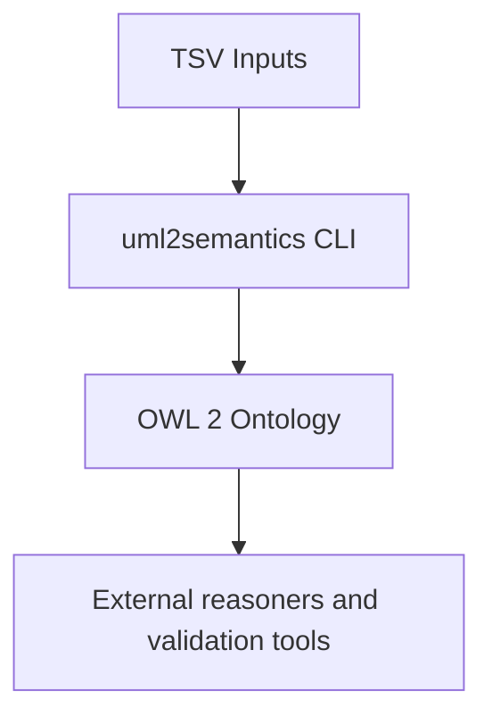

# uml2semantics

Convert UML-style TSV specifications into OWL 2 ontologies. Model classes,
properties, enumerations, datatype facets, choice patterns, annotations, and
property chains, then export RDF/XML, Turtle, JSON-LD, N-Triples, TriG, or N3.

## Start here

- [Install and convert your first model](Getting-Started.md).
- [Build the ISO 20022 ontology](Examples.md#10-build-the-iso-20022-ontology).
- [Look up CLI options](CLI-Usage.md) and [TSV columns](TSV-Specification.md).
- [Use the Python API](Python-API.md).
- [Diagnose errors and warnings](Troubleshooting.md).

## Model semantics

[Choices](Choice-Patterns.md), [datatypes and facets](Datatypes-and-Facets.md),
[enumerations](Enumerations.md), [annotations](Annotations.md), and
[property chains](Property-Chains.md) explain the supported mappings.

## Develop and maintain

Read the [architecture](Architecture.md), [test coverage](Golden-Tests.md),
and [documentation workflow](Documentation.md).
The repository retains the canonical [changelog](https://github.com/chris-day/uml2semantics-python/blob/main/CHANGELOG.md)
and [Apache-2.0 license](https://github.com/chris-day/uml2semantics-python/blob/main/LICENSE).

## Attribution

Based on Henriette Harmse's
[UML-to-OWL reference](https://henrietteharmse.com/uml-vs-owl/uml-class-diagram-to-owl-and-sroiq-reference/)
and [reference implementation](https://github.com/henrietteharmse/uml2semantics).
For a larger example, see [ISO-20022](https://github.com/chris-day/ISO-20022).

These pages consolidate the original project wiki. Maintain documentation in
this repository's `docs/`; the separate wiki is retained as a historical source.
